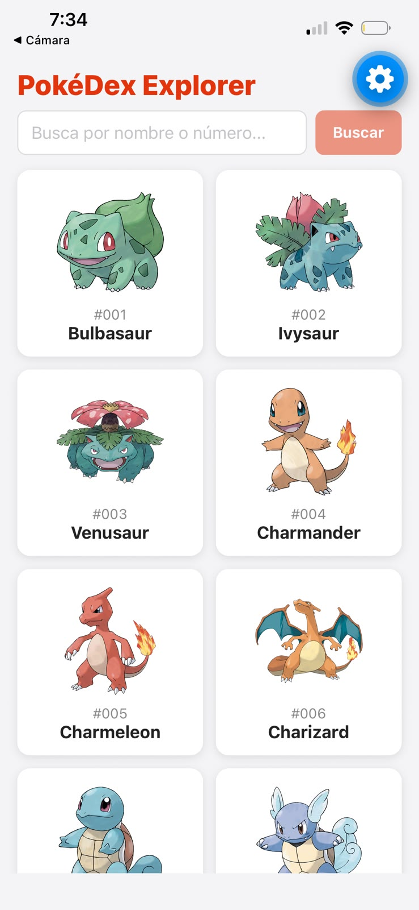
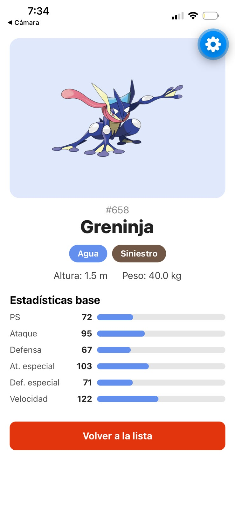
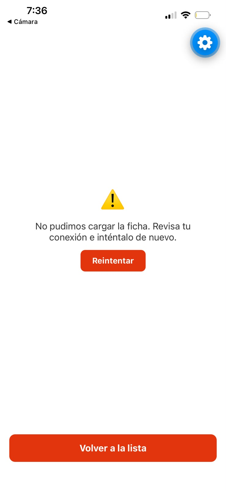
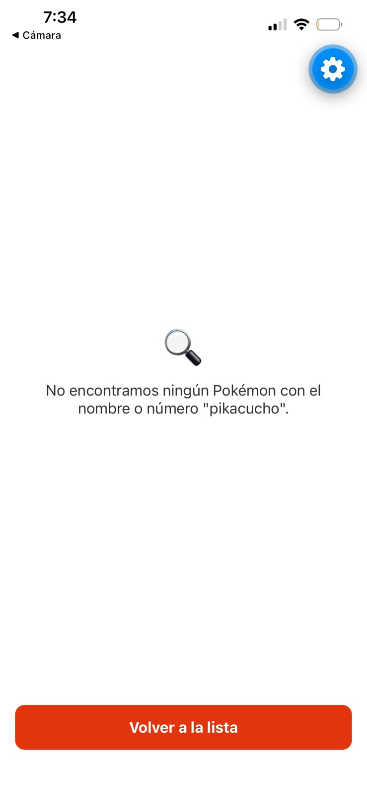

# PokéDex Explorer

App móvil hecha con React Native y Expo que consume la [PokéAPI](https://pokeapi.co/). Lista Pokémon con scroll infinito, permite buscarlos por nombre o número y muestra su ficha con imagen, tipos, altura, peso y estadísticas base.

**Autor:** [Maicol Franco Lloreda] · **Curso:** Desarrollo móvil · **Docente:** Paula Andrea Muñoz Correa

## Cómo ejecutarla

```bash
git clone https://github.com/Maicolfranco707/pokedex-explorer.git
cd pokedex-explorer
npm install
npx expo start
```

Escanea el QR con la app Expo Go (SDK 58), o presiona `a` (Android) o `i` (iOS).

## Funcionalidades

- Lista de 20 Pokémon en cuadrícula de 2 columnas, con scroll infinito.
- Búsqueda por nombre o número (ignora mayúsculas, espacios y ceros a la izquierda).
- Ficha con imagen, tipos con color propio, altura, peso y 6 estadísticas base.
- Estados de la interfaz: cargando, error con botón "Reintentar", sin resultados y éxito.

## Arquitectura

```
pokedex-explorer/
├── App.js
└── src/
    ├── api/
    │   └── pokeApi.js
    ├── hooks/
    │   ├── usePokemonList.js
    │   └── usePokemonDetail.js
    ├── screens/
    │   ├── ListScreen.js
    │   └── DetailScreen.js
    ├── components/
    │   ├── PokemonCard.js
    │   ├── SearchBar.js
    │   ├── TypeBadge.js
    │   ├── StatBar.js
    │   └── StateViews.js
    ├── constants/
    │   └── pokemonTypes.js
    └── utils/
        └── format.js
```

| Archivo | Responsabilidad |
|---------|-----------------|
| `App.js` | Punto de entrada. Guarda qué Pokémon está abierto y muestra la lista o la ficha. No usa Expo Router. |
| `src/api/pokeApi.js` | Única capa de red: `fetch`, revisión de `response.ok`, distinción del error 404 y transformación de las respuestas. |
| `src/hooks/usePokemonList.js` | Carga la lista de 20 en 20, controla el estado (cargando, error, éxito) y evita pedir dos páginas a la vez. |
| `src/hooks/usePokemonDetail.js` | Carga la ficha de un Pokémon y distingue "no existe" de "falló la conexión". |
| `src/screens/ListScreen.js` | Pantalla de la lista: encabezado, búsqueda y `FlatList` con scroll infinito. |
| `src/screens/DetailScreen.js` | Pantalla de la ficha, con los cuatro estados de la interfaz. |
| `src/components/PokemonCard.js` | Tarjeta con imagen, número y nombre. |
| `src/components/SearchBar.js` | Campo de texto y botón "Buscar". |
| `src/components/TypeBadge.js` | Distintivo de color para cada tipo. |
| `src/components/StatBar.js` | Barra de ancho proporcional para una estadística. |
| `src/components/StateViews.js` | Vistas de cargando, error y sin resultados. |
| `src/constants/pokemonTypes.js` | Colores de los tipos y traducciones al español. |
| `src/utils/format.js` | Funciones puras: formatear el número, poner mayúscula inicial y normalizar la búsqueda. |

### Por qué esa organización

- **La red está separada de la interfaz.** Solo `api/pokeApi.js` conoce `fetch` y las URLs. Si la API cambia, se modifica un único archivo.
- **Los hooks guardan el estado.** Las pantallas no manejan peticiones: miran el `status` y deciden qué mostrar.
- **Componentes pequeños y reutilizables.** `TypeBadge`, `StatBar` y `StateViews` no dependen de ninguna pantalla.
- **Constantes y utilidades aparte** para no repetir colores, traducciones ni formato de números.
- **Sin librerías de red:** se usa `fetch`, que ya viene incluido.

### Decisiones técnicas

- La búsqueda abre la ficha, que maneja sus propios estados (cargando, error, no existe, éxito).
- La lista queda montada, pero oculta, mientras se ve la ficha, para conservar el scroll y las páginas ya cargadas.
- Se usa un `ref` para guardar el offset y evitar peticiones duplicadas mientras se carga una página.
- El botón atrás de Android cierra la ficha.

## Capturas

| Lista | Ficha |
|-------|-------|
|  |  |

| Error | Sin resultados |
|-------|----------------|
|  |  |

## Reflexión

**1. ¿Cómo influye el array de dependencias de `useEffect` en las peticiones a la API?**
El array decide cuándo se vuelve a ejecutar el efecto. En `usePokemonList` uso `[loadPage]`, y como `loadPage` está envuelta en `useCallback` con un array vacío, nunca cambia: la primera página se pide una sola vez al abrir la app. En `usePokemonDetail` uso `[reference, attempt]`, así que la ficha solo se vuelve a pedir si cambia el Pokémon o si el usuario pulsa "Reintentar". Si omitiera el array, el efecto correría después de cada render, y como cada petición actualiza el estado y provoca otro render, se generaría un ciclo infinito de peticiones.

**2. ¿Por qué es importante separar la lógica de red de los componentes?**
Porque cada archivo tiene una sola responsabilidad. En mi proyecto, `api/pokeApi.js` es el único que conoce las URLs y usa `fetch`; los hooks guardan el estado y los componentes solo dibujan lo que reciben. Si la API cambia de URL o de formato, modifico un solo archivo sin tocar estilos ni JSX. Además los componentes quedan más simples y reutilizables.

**3. ¿Por qué `FlatList` y no `ScrollView` con `map`?**
`FlatList` solo dibuja los elementos que están visibles en pantalla, así que gasta menos memoria con listas largas como la de Pokémon, que puede crecer a más de mil. Un `ScrollView` con `map` dibuja todos los elementos cargados a la vez. Además `FlatList` trae `numColumns` para la cuadrícula de 2 columnas y `onEndReached` para el scroll infinito.

**4. ¿Qué problema tuve y cómo lo resolví?**
Al crear el proyecto elegí Expo SDK 57 creyendo que era la compatible con Expo Go. Al escanear el QR con mi iPhone salió el error "Project is incompatible with this version of Expo Go": en iOS solo se puede usar la última versión de Expo Go (SDK 58) y no se puede instalar una anterior. Lo resolví borrando el proyecto y creándolo de nuevo con SDK 58, y reinstalé la librería `react-native-safe-area-context` con `npx expo install` para que quedara la versión compatible.